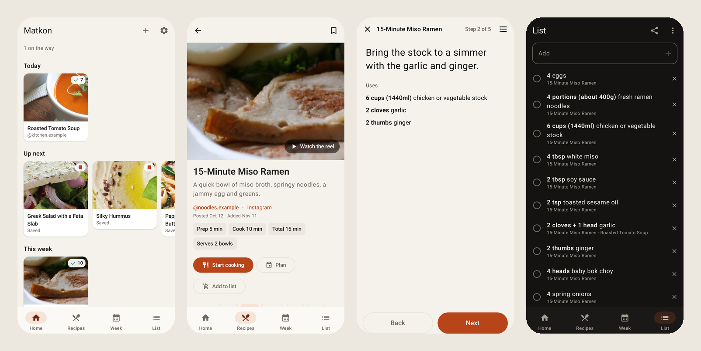
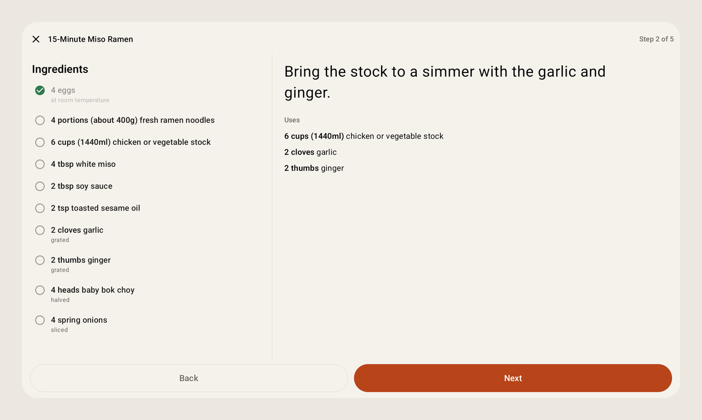

<p align="center"></p>

<h1 align="center">Matkon for Android</h1>

<p align="center">The kitchen half of <a href="https://github.com/franz-rosenzweig/matkon">Matkon</a>, on a phone or a tablet.</p>

<p align="center">
  <a href="https://github.com/franz-rosenzweig/matkon-android/releases/latest"></a>
  
  <a href="LICENSE"></a>
</p>

<p align="center"></p>

Matkon turns the cooking reels I save on Instagram into proper recipe pages. This is its Android app. It reads the same recipes, from the same Matkon server, and it's built for actually standing at the counter with a phone or a tablet propped up next to the stove.

## What it does

The recipes come in from Matkon with everything the web page has: both languages for Hebrew recipes, the creator, when it was posted and when it was saved, and the reel's own video if I want to watch the move I can't picture from the words.

Then there are the things I wanted from an app in the kitchen:

- **Cook mode.** One step at a time, in big type, and the screen stays on. Swipe or tap Next. Each step shows the ingredients it uses with their amounts, so I'm not scrolling back up with flour on my hands. On a tablet on its side, the ingredient list sits next to the steps.
- **Step timers.** When a step says "bake 25 minutes," there's a button for it. The timer rings like an alarm clock even if the phone is asleep or I've gone to another app.
- **Amounts.** Half, one and a half, double, triple. The amounts are worked out from what the reel gives, and anything without a number ("salt to taste") stays as it is.
- **The week.** I put recipes on days, this week and next, and the whole week can go onto the shopping list at once.
- **The shopping list.** Ingredients from different recipes are added together where they can be ("1 cup" and "½ cup" of the same thing become "1½ cups"), and I tick things off in the store. It's the same list on every device signed in to the same Matkon account, so whoever's at the store sees it.
- **Made it, ratings and notes.** The same memory the web app keeps: what I've made and when, a rating out of ten, and a note for next time.
- **Share a reel straight in.** From Instagram, Share → Matkon, and it goes into the queue.
- **Offline.** Every recipe and its photo stays on the device, so the kitchen still works when the Wi-Fi doesn't reach. Anything I change offline goes to the server once it's back.

<p align="center"></p>

## Getting it

It's on GitHub Releases. The easiest way to install it and keep it up to date is [Obtainium](https://github.com/ImranR98/Obtainium): add an app and paste this repository's address. Or download the APK from the [latest release](https://github.com/franz-rosenzweig/matkon-android/releases/latest) and open it.

It needs a Matkon server to talk to. On the first screen, type the server's address and your Matkon username and password.

## Where it came from

I didn't start from nothing. This began as a fork of Lukas Neugebauer's [Nextcloud Cookbook for Android](https://github.com/lneugebauer/nextcloud-cookbook), which is MIT-licensed, and kept its build setup and its Material 3 feel. Matkon's recipes are shaped differently from Nextcloud's (two languages, a video, timers in the steps, amounts kept apart from the ingredient), so the screens and the data side were rewritten for them. If you keep your recipes in Nextcloud Cookbook, Lukas's app is the one you want.

## Building

You need JDK 17 and the Android SDK (platform 36).

```bash
./gradlew :app:assembleDebug
```

A release build is signed with the keys named in a `keystore.properties` next to this file (`storeFile`, `storePassword`, `keyAlias`, `keyPassword`), which is never committed.

The pictures here come from Matkon's demo: made-up recipes with public-domain photos, nothing from a real collection.

## License

MIT, like the app it started from. See [LICENSE](LICENSE).
